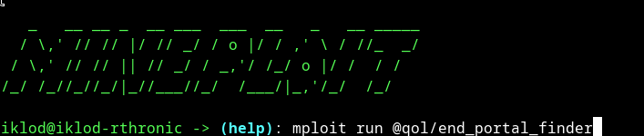
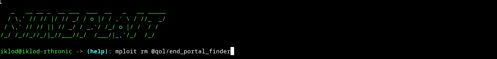

# NitroPackage - Python scripts package manager (not pip or uv for user to use)
NitroPackage is a package manager for Python scripts that requires 0.01% of your brainpower—that’s how simple it is.

### Install mineploit
1. Clone this repo
```bash
git clone https://github.com/Starfish-Foundation/nitropackage.git
```
#### Note use py for windows or python if you on linux,MacOS
2. Make virtual env (venv)
2.1. Using uv
    ```bash
    uv venv
    ```
    2.2. using built-in 
    ```bash
    python3 -m venv [name of your path]
    ```
3. install requirements.txt content
    ```bash
    uv pip install -r requirements.txt
    ```
    built-in python
    ```
    pip install -r requirements
    ```
4. run src/app.py
    ```bash
    python3 src/app.py
    ```
5. Done


# Usage

## Install package (with example)

## remove package (with example too)


# How contribute own package
If you want to share your script, you must meet these requirements.
1. Must be on permissive licence like MIT, Apache 2.0, Public domain
2. ANY GPL ISNT ALLOWED BECAUSE ITS VIRUS TYPE LICENCE
3. maintain it if have complicated logic (simple math modules can be unmaintained)
### if you done all of this requirements you need:
1. Contact me in issues
2. we talk about introducing it
3. and will be distributet in next drop (drop is big package adding to repo)
4. Done

##### for more questions... ask on Issues :)